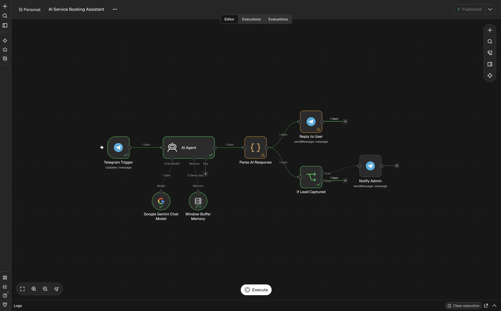
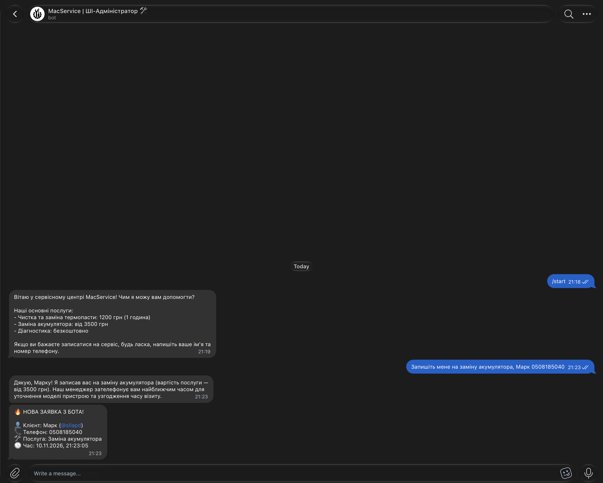

# 🤖 AI Service Booking Assistant (Telegram + n8n + Google Gemini)

An automated AI-powered Telegram receptionist designed for local service businesses (demonstrated on an Apple MacBook repair center). Built with **n8n**, **Google Gemini AI (LangChain)**, and custom **JavaScript** parsing.

---

## 🖼 Architecture & Demo

### n8n Workflow Architecture

### Live Telegram Demo

---

## ✨ Key Features (English)

* **24/7 AI Consultation:** Uses `Google Gemini Chat Model` via an n8n `AI Agent` node to answer customer inquiries strictly based on the business price list.
* **Context-Aware Memory:** Integrated `Window Buffer Memory` linked to each user's Telegram `chat.id` so the bot remembers the conversation flow.
* **Automated Lead Extraction (JavaScript):** A custom `Parse AI Response` Code node detects when a customer submits their name and phone number, extracts the structured data via RegExp, and strips internal tags before replying to the user.
* **Instant Admin Alerts:** Routes captured leads through an `If Lead Captured` node and sends a formatted notification card directly to the business owner's Telegram.

---

## 🇺🇦 Опис проєкту (Українською)

Розумний ШІ-адміністратор у Telegram для автоматизації запису клієнтів та відповідей на часті запитання за прайсом компанії.

### Як працює система:
1. **`Telegram Trigger`** — приймає вхідні повідомлення від користувачів у реальному часі.
2. **`AI Agent` + `Google Gemini Chat Model` + `Window Buffer Memory`** — аналізує запит клієнта з урахуванням історії діалогу та відповідає за заданим прайс-листом сервісного центру.
3. **`Parse AI Response` (JavaScript)** — перевіряє відповідь ШІ. Якщо клієнт залишив ім'я та номер телефону для запису, скрипт виділяє їх у змінні (`clientName`, `clientPhone`, `service`) і додає точний час замовлення (`Europe/Kyiv`).
4. **`Reply to User` & `If Lead Captured` $\rightarrow$ `Notify Admin`** — клієнт отримує чисту ввічливу відповідь, а адміністратору миттєво надходить картка нової заявки.

---

## 🚀 Quick Start / Як запустити у себе

1. Run **n8n** (via Docker or Desktop).
2. Download the [`workflow.json`](./workflow.json) file from this repository and import it into your n8n canvas (`Cmd/Ctrl + V`).
3. Add your **Telegram Bot Token** (from `@BotFather`) to the Telegram nodes.
4. Add your **Google Gemini API Key** (from Google AI Studio) to the `Google Gemini Chat Model` node.
5. Activate the workflow and send a message to your bot!
